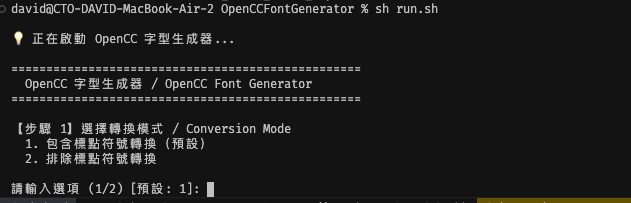
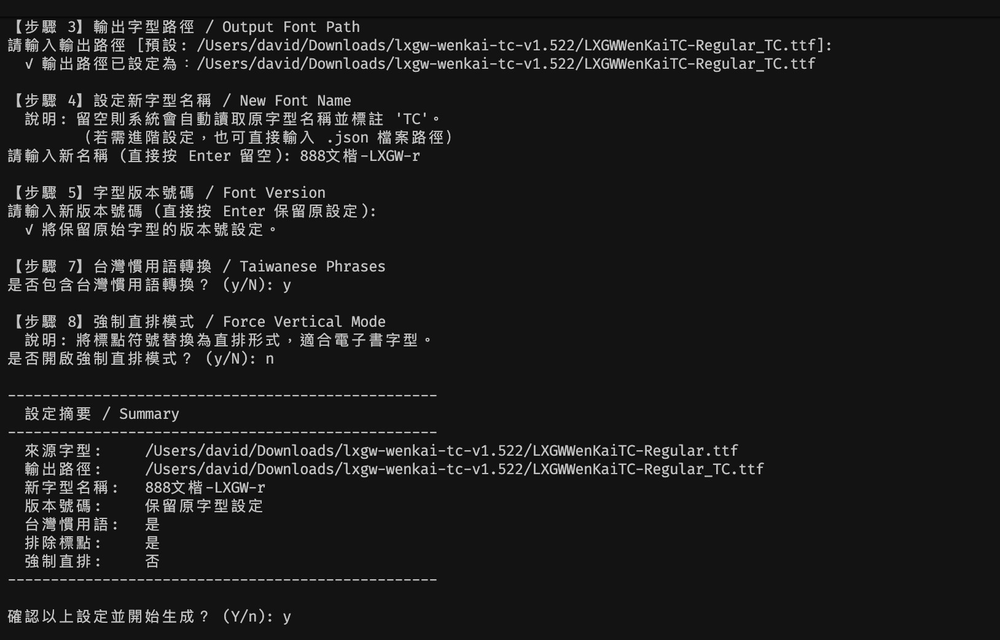
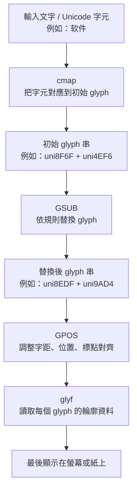

# OpenCC 字型生成器 / OpenCC Font Generator
<p align="center">
  
  
</p>

---

## 關於本專案 / About This Fork

本專案是基於 [ayaka14732/OpenCCFontGenerator](https://github.com/ayaka14732/OpenCCFontGenerator) 的分支版本，由 [tbdavid2019](https://github.com/tbdavid2019) 維護。

感谢原作者 **ayaka14732** 的出色工作，奠定了本工具的核心基礎。本分支在原版基礎上新增了以下功能：
- **Kindle 極致優化**：針對 Kindle 等閱讀器缺字問題，自動將缺少的簡體編碼直接映射到繁體字形 (cmap mapping)，確保不回退系統字型。
- **變體補全 (Variant Supplement)**：自動補全字型中缺少的異體字編碼（如「妳」對應到「你」），大幅減少缺字率。
- **WOFF2 支援**：支援 `.woff2` 作為輸入字型，並可選擇同時輸出 WOFF2 格式。
- **Webfont 生成器**：獨立的 WOFF2 轉換工具，自動產出 `@font-face` CSS 範例。
- **偽直排旋轉 (90° Rotation)**：針對舊型電子書設備，提供將字元順時針旋轉 90 度（躺平）的功能。
- **多樣化轉換標準**：支援 `s2hk` (香港)、`s2tw` (台灣) 與 `t2s` (繁轉簡) 等 OpenCC 標準。
- **字型補全 (Glyph Fallback)**：自動從備用字型提取並注入缺失的字形，徹底解決缺字 (豆腐塊) 問題。
- **通用型 Merge Font 模式**：可選擇保留來源字庫，並把 fallback 中來源缺少的所有 codepoint 一起合併進輸出字型。
- **Variable CJK Family Builder**：將 variable 拉丁字型展開成多個權重，並與對應 CJK fallback 字型合成一整套 family。
- **Static Font Family Builder**：將一個或一整組非 variable 的靜態字型批次處理，並依字重自動配對對應的 fallback 字型。
- **`--no-punc`**：可選擇性地排除標點符號的轉換。
- **`--force-vertical`**：自動替換標點符號為直排形式（適合電子書直排字型）。
- **`start.py`**：互動式精靈啟動器，提供引導式問答介面。

---

將 OpenCC 簡繁轉換邏輯嵌入 OpenType 字型，使用者下載並安裝字型後，所有文字將自動以目標字形呈現，無需任何軟體設定。

> Embed OpenCC conversion rules into an OpenType font. Once installed, any application that renders with the font will automatically display target glyphs (Traditional or Simplified) — no software configuration required.

---

## 運作原理 / How It Works

本工具會在字型的 **GSUB（字形替換）表**中建立 OpenCC 替換規則，並掛到標準 OpenType feature（如 `liga`、`rlig`、`ccmp`），利用 OpenCC 字典將字形映射到對應的目標字形，包含詞彙層面的多對一替換（例如「软件」→「軟體」）。

當開啟「字型補全」功能時，程式會檢查來源字型是否缺少目標字元，並自動從備用字型中抓取所需的字形數據注入到輸出字型中。
即使來源字型本身沒有 `GSUB` 或 `GPOS` 表，也可正常完成缺字補全與清理流程。

## 字型術語小教室 / Font Terms 101

如果您第一次接觸字型內部結構，可以先把字型想成一個小型資料庫：

### 什麼是 glyph？

`glyph`（字形）是字型裡實際拿來畫在螢幕或紙上的圖形單位。  
它不等於 Unicode 字元本身。

例如：
- Unicode `U+4F60` 是字元「你」
- 字型裡可能有一個 glyph 叫 `uni4F60`
- 也可能有不同 glyph 對應同一個字元，例如直排版、異體字、簡繁替代字

所以：
- **字元（character）** 是文字編碼概念
- **glyph** 是字型內部的圖形資產

### 什麼是 cmap？

`cmap` 是 **character map**，負責把「Unicode codepoint」對到「glyph」。

例如：
- `U+4F60` -> `uni4F60`
- `U+3001` -> `uni3001`

沒有 `cmap`，系統就不知道您輸入的字元應該拿哪個 glyph 來顯示。

### 什麼是 glyf？

`glyf` 是 TrueType 字型中存放 glyph 輪廓資料的表。  
它描述這個 glyph 長什麼樣子，例如：
- 輪廓點
- 曲線
- composite references（引用其他 glyph 組成新的 glyph）

可以這樣記：
- `cmap` 決定「**用哪個 glyph**」
- `glyf` 決定「**那個 glyph 長怎樣**」

### 什麼是 GSUB？

`GSUB` 是 **Glyph Substitution**，也就是「字形替換表」。

它會在排版時，把一個 glyph 或一串 glyph 換成另一個 glyph 或 glyph 串。

常見用途：
- 連字：`f` + `i` -> `fi`
- 簡轉繁：`后` -> `後`
- 詞級替換：`软件` -> `軟體`
- 直排替代字形

本專案的核心，就是大量利用 `GSUB` 來實作 OpenCC 簡繁轉換。

### 為什麼我的繁體字型轉完後在 Kindle 上還是顯示簡體？

這通常是因為**缺字回退 (Font Fallback)**。

如果您的輸入字型是純繁體字型（例如 `jf金萱`），它可能完全沒有收錄簡體字碼位的編碼。在舊版邏輯中，程式因為發現來源字型沒有簡體字編碼，會跳過該字的轉換規則。當 Kindle 顯示這些簡體字時，因為字型不含這些碼位，Kindle 會自動改用系統預設字型顯示，導致看起來像是沒轉好。

### 解決方案：cmap 強制映射與變體補全

為了徹底解決這個問題，本分支引進了以下機制：

1. **cmap 直接映射**：
   - 只要目標繁體字在字型中，程式會直接在字型的 `cmap` 表中加入對應簡體字的編碼，並指向該繁體字形。
   - 這是一種「硬核」轉換，不依賴軟體是否支援 OpenType 特性，在所有電子書閱讀器上都有效。

2. **變體補全 (Variant Supplementing)**：
   - 讀取 `Variants.txt` 等異體字表，自動將字型中缺少的異體字（如「妳」）編碼指向現有的對應字形（如「你」）。
   - 這能最大程度利用字型現有資源，減少「豆腐塊」缺字現象。

### 什麼是 GPOS？

`GPOS` 是 **Glyph Positioning**，也就是「字形定位表」。

它不負責換字形，而是負責調整 glyph 的位置或間距。

常見用途：
- kerning 字距微調
- 注音或重音符號定位
- 複雜文字排版時的位置修正
- 標點或組合符號的精細對齊

所以差別是：
- `GSUB` = 換 glyph
- `GPOS` = 不換 glyph，只調整位置

### 一句話總結

- `glyph`：字型裡的一個實際字形
- `cmap`：字元 -> glyph 的對照表
- `glyf`：glyph 的輪廓資料
- `GSUB`：glyph 替換規則
- `GPOS`：glyph 定位規則

### 字型渲染流程圖 / Font Rendering Flow

下面這張圖可以幫助理解：當應用程式顯示文字時，字型內部大致會經過哪些步驟。



用更白話的方式講：

1. 使用者輸入的是 Unicode 文字。
2. `cmap` 先決定每個字元要拿哪個 glyph。
3. `GSUB` 再視需要把 glyph 換成另一個 glyph，或換成整串新的 glyph。
4. `GPOS` 負責把這些 glyph 排好位置。
5. `glyf` 提供每個 glyph 的實際形狀，最後才被畫出來。

本專案做的事情，主要就是在這個流程中強化 `GSUB`，並在缺字時補上必要的 `cmap` 與 `glyf` 資料。

### 重要限制 / Important Limitation

OpenType 字型的 glyph 數量上限為 `65,535`。本專案為了實現 OpenCC 的**詞彙級**轉換，會額外建立約 4 萬個中介用 pseudo glyph 與 GSUB 規則：

- **中小型字型（來源字形 + OpenCC 詞條 `<= 65,535`）**：預設完整保留原始字型所有字形與編碼，不做裁剪。
- **大型完整 CJK 字型（如 4.5 萬～5 萬 glyphs，加上詞條後會超過 `65,535`）**：在非 `universal` 模式下，程式會**自動進入 subset 保護**——優先保留 OpenCC 詞彙級轉換所需的 Han 字、常用非 Han 範圍與 fallback 補入字形，並裁剪其餘冗餘字形以確保能成功編譯。

因此大型字型的 `_TC` 輸出會較接近「**針對 OpenCC 轉換優化的 subset font**」，而不是原字型的完整鏡像副本。

---

## 安裝前置需求 / Prerequisites

```bash
pip install -r requirements.txt
python setup.py build  # 下載 OpenCC 資料並生成快取 (包含新標準)
```

同時需要安裝 [otfcc](https://github.com/caryll/otfcc)（`otfccdump` 與 `otfccbuild`）。

---

## 使用方法 / Usage

### 方法一：全自動快速啟動（推薦：免環境設定 & 同步友善）
如果您在 macOS 並希望自動管理環境，請直接執行：

```bash
sh run.sh
```
此腳本會自動建立虛擬環境、建置快取並啟動精靈。

---

### 方法二：手動執行互動式精靈 / Interactive Wizard
如果您已自行設定好環境，請執行：

```bash
python start.py
```

... (Steps 1-10 unchanged)

---

### 方法三：90度順時針旋轉 (偽直排) / 90-Degree Rotation
針對僅支援水平顯示的舊型電子書設備，您可以使用此功能讓字體「躺平」，旋轉設備後即可像直排一樣閱讀。

**最佳實踐 (Best Practice):**
1. 執行 `sh run.sh`：先將您的簡體字型轉換為 **繁體字型 (如 `_TC.ttf`)**。
2. 執行 `sh run90.sh`：輸入剛生成的繁體字型，將其 **順時針旋轉 90 度**。
3. 輸出結果為 `_TC_Rotated90.ttf`。

```bash
sh run90.sh
```

**功能特點:**
- **幾何中心旋轉**: 以字元中心點旋轉，確保排版整齊。
- **僅旋轉漢字選項**: 支援中英混排，讓英數保留原樣，僅中文字躺平。
- **全域度量修正**: 自動調整字高與寬度，模擬直排等寬感。

---

### 腳本功能總覽 / Script Overview

| 腳本 | 主要功能 | 適用場景 |
|------|----------|----------|
| `run.sh` | OpenCC 轉換 (精靈) | 核心功能，將簡體字型轉為繁體 (支援 WOFF2) |
| `run90.sh` | 90度順時針旋轉 (精靈) | 進階功能，針對不支援直排的舊設備進行偽直排處理 |
| `runVF.sh` | Variable CJK Family Builder (精靈) | 將 variable 拉丁字型展開成多權重 CJK family |
| `runSTATIC.sh` | Static Font Family Builder (精靈) | 批次處理單一靜態字型或整組靜態字重 family |
| `runWEBFONT.sh` | Webfont 轉換 (精靈) | 獨立功能，將 TTF/OTF 轉為 WOFF2 並產出 CSS |
| `start.py` | 核心轉換對話入口 | 手動啟動 OpenCC 轉換精靈 |
| `start90.py` | 旋轉對話入口 | 手動啟動 90 度旋轉精靈 |
| `startVF.py` | Variable Family 對話入口 | 手動啟動 variable 拉丁 + CJK fallback 合成精靈 |
| `startSTATIC.py` | Static Family 對話入口 | 手動啟動靜態字型批次處理精靈 |
| `startWEBFONT.py` | Webfont 對話入口 | 手動啟動 Webfont 轉換精靈 |

---

### 方法四：命令列參數 / CLI Arguments

```bash
python -m OpenCCFontGenerator \
  -i <來源字型> \
  -o <輸出字型> \
  [--woff2] \
  [--config <s2t|twp|s2tw|s2hk|t2s>] \
  [--fallback-font <備用字型路徑>] \
  [--merge-mode <opencc|universal>] \
  [--fill-charset <none|hant-common|opencc-hant|han>] \
  [--font-name <新字型名稱>] \
  [--font-version <版本號碼>] \
  [--no-punc] \
  [--force-vertical]
```

#### 參數說明 / Parameters

| 參數 | 說明 | 必填 |
|------|------|------|
| `-i`, `--input-file` | 來源字型路徑（.ttf / .otf / .ttc / .woff2） | ✅ |
| `-o`, `--output-file` | 輸出字型路徑 | ✅ |
| `--woff2` | 是否額外輸出 WOFF2 格式 | ❌ |
| `--kobo` | 開啟 Kobo eReader 相容模式，強制清理 metadata | ❌ |
| `--config` | OpenCC 配置（預設: `s2t`） | ❌ |
| `--fallback-font` | 備用字型路徑（用於補齊缺字） | ❌ |
| `--merge-mode` | 補字模式：`opencc` 僅補轉換目標字；`universal` 會保留來源字庫並合併 fallback 缺少字元 | ❌ |
| `--fill-charset` | 先主動從 fallback 補指定字集；`hant-common` 適合先補常用繁中字區 | ❌ |
| `--font-name` | 新字型的名稱 | ❌ |
| `--font-version` | 覆寫字型版本號碼 | ❌ |
| `--twp` | 快捷鍵：啟用台灣慣用語轉換 (等同 `--config twp`，注意可能超翻，見下方說明) | ❌ |
| `--no-punc` | 排除標點符號的轉換 | ❌ |
| `--force-vertical` | 強制直排模式 | ❌ |

#### `--config` 轉換模式怎麼選？（避免「超翻」必看）

| 模式 | 轉換內容 | 適用情境 |
|------|----------|----------|
| **`s2tw`**（**日常最推薦**） | 簡轉繁（含 `後來`/`頭髮`/`發現`/`皇后`/`業餘`/`面`/`麵條` 等詞級消歧）＋ 台灣標準異體字形（如 `為`、`裡`、`麵`） | **繁體環境日常通用／閱讀簡體文章最安全**。只轉字形、不改詞彙、不改字數，**不會超翻**。 |
| `s2t` | OpenCC 標準簡轉繁（含詞級消歧），不額外套用台灣字形變體 | 偏好 OpenCC 通用繁體標準、不想套用地區字形微調時。 |
| **`twp`**（或 `--twp`） | 簡轉繁 ＋ 台灣字形 ＋ **台灣慣用語詞彙替換**（`opencc-data` 詞表含 `1,654` 條片語與 `21` 個單字替換） | **僅建議專門讀大量簡體小說／中國技術文章且想自動換詞時使用**（風險見下方說明）。 |
| `s2hk` | 簡轉繁 ＋ 香港字形標準 | 香港字體標準需求。 |
| `t2s` | 繁體轉簡體 | 需要將繁體文字顯示成簡體時。 |

> [!WARNING]
> **為什麼一般字型不建議直接用 `twp`（超翻與排版錯位風險）？**
> 1. **繁體日常詞彙也會被硬換**：字型 GSUB 規則無法區分文章原本是簡體還是繁體，套用 `twp` 後，台灣自己常寫的繁體詞也會被改寫——例如「**文件**」→「**檔案**」、「**程序**（法律程序）」→「**程式**」、「**支持**」→「**支援**」、「**默認**」→「**預設**」、「**項目**」→「**專案**」、「**高級**」→「**高階**」、「**打印**」→「**列印**」；單字 `硅` 也會無條件變成 `矽`。
> 2. **字數變化造成游標與斷行錯位**：`twp` 內有 **`463` 條來源與輸出字數不同的規則**（例如 2 字詞 `高清`→`高畫質`、`藍屏`→`藍色畫面`、`編程`→`程式設計`）。底層 Unicode 字元數不變但畫面拉長，在編輯器／閱讀器中反白選字與換行位置容易對不齊。
>
> **建議**：若只想讓簡體內容以正確台灣正體顯示、同時不破壞正常繁體閱讀體驗，請優先使用 **`--config s2tw`**。

---

## Kobo 相容模式 (`--kobo`)

Kobo eReader 對於側載字型 (sideloaded fonts) 的元資料（metadata）解析非常嚴格。如果輸出的字型在 Kobo 上出現無法群組、未辨識，或中文字型名稱顯示亂碼等問題，請加上 `--kobo` 參數（或在互動精靈中開啟）。

這個模式會：
- 將 Family Name (家族名稱) 中的空格去除。
- 強制過濾掉 `name` table 中非 ASCII、或非純英文（如 `zh-TW` 繁中）的字串紀錄，確保 Kobo 只能讀取乾淨的英文命名紀錄，以避免它隨機挑選到無法解析的中文名稱。

---

## 重大功能說明：字型補全 `--fallback-font`

當您將一個原本只有簡體字的字型轉換為繁體時，如果該字型檔案中根本沒有繁體字形，轉換後的文字會變成「豆腐塊」。

現在，您可以指定一個「備用字型」（例如：思源黑體繁體版），工具會自動從中提取缺失的繁體字形並合併到您的輸出字型中。

預設情況下，`--fallback-font` 的作用是補齊轉換目標所需的缺字，不會改變本工具整體的 subset 輸出策略。

如果您的來源字型本身繁中字區不完整，建議搭配 `--fill-charset hant-common`，先主動從 fallback 補常用繁中字集，再進行 OpenCC 轉換。

```bash
python -m OpenCCFontGenerator \
  -i MyFont.ttf \
  -o MyFont_TC.ttf \
  --fallback-font NotoSansTC-Regular.ttf \
  --fill-charset hant-common \
  --merge-mode universal
```

### `--fill-charset` 選項差異

目前支援的值有：

- `none`
- `hant-common`
- `opencc-hant`
- `han`

請注意：**在目前版本中，`hant-common` / `opencc-hant` / `han` 三者在實作上暫時等價**，都會使用專案內建的 Han codepoint cache 先補字。

也就是說，現階段它們的差別主要是**語意命名**，方便未來拆分成更細的補字策略：

- `han`：偏廣義 Han 字集合
- `hant-common`：偏常用繁中字集
- `opencc-hant`：偏 OpenCC 轉換相關繁中字集

如果您目前的目標是：
- 先補足來源字型缺少的繁體中文字
- 再讓 OpenCC 自動把簡體顯示成繁體

那麼**這是可以同時做到的**，建議直接使用：

```bash
--fill-charset hant-common --merge-mode universal --config s2t
```

這組參數的意義是：

1. 先從 fallback 補常用繁中字
2. 再保留來源字庫並合併其他缺字
3. 最後套用 OpenCC 簡轉繁規則

所以答案不是「沒法既要又要」，而是：

- **可以既要又要**
- 只是要先補字，再做 OpenCC
- 目前最推薦的組合就是 `hant-common + universal + s2t`

如果您需要更接近「通用型 merge font」的行為，可以改用：

```bash
python -m OpenCCFontGenerator \
  -i MyFont.ttf \
  -o MyFontMerged.ttf \
  --fallback-font FallbackFont.ttf \
  --merge-mode universal
```

`universal` 模式會：
- 保留來源字型原本的 `cmap` 字庫
- 將 fallback 字型中來源缺少的 codepoint 一起併入
- 仍可選擇疊加 OpenCC 規則

請注意：
- 大型字型更容易碰到 OpenType 約 `65535` glyph 上限
- 目前主要合併 `cmap`、`glyf` 與基本 metrics；不是完整整併兩套字型排版系統的 full font editor

## Variable CJK Family 流程

如果您的來源字型是像 `MonoLisaVariableNormal.ttf` 這類 variable font，但本身只有英數、沒有繁體中文，那麼比較務實的做法不是硬做成單一真正的 variable CJK font，而是：

1. 將 variable font 依常見權重展開成多個 static instance  
   例如：`Thin / Regular / Medium / Bold / Black`
2. 為每個權重找對應的 CJK fallback 字型  
   例如：`NotoSansTC-Regular.ttf`、`NotoSansTC-Bold.ttf`
3. 逐個權重執行 `merge_mode=universal` 合成
4. 最後輸出一整套可安裝、可選重的 CJK family

您可以直接執行：

```bash
sh runVF.sh
```

這個流程適合：
- 英數保留 variable 拉丁字型風格
- 中文由 Noto 或其他 CJK 字型補齊
- 同時保留 OpenCC 簡繁轉換能力

請注意：
- 這會得到「一整套多權重 family」
- 不是單一真正的 variable CJK 字型
- 如果 fallback 本身是 static 字型，中文部分不會真正擁有 variable interpolation 資料
- 目前 `runVF.sh` 預設也會先執行 `fill-charset = hant-common`，優先補常用繁中字

## Static Font Family 流程

如果您的來源不是 variable font，而是一個或一整組靜態字型，例如：

- `MyFont-Regular.ttf`
- `MyFont-Medium.ttf`
- `MyFont-Bold.ttf`

那麼可以使用：

```bash
sh runSTATIC.sh
```

這個流程會：

1. 接受單一字型檔，或整個資料夾
2. 自動依檔名判斷字重，例如 `Regular / Medium / Bold`
3. 從 fallback 資料夾中尋找對應字重的字型
4. 逐個權重套用 OpenCC 與 fallback 合成
5. 批次輸出整組 `_TC` 字型

適合場景：

- 您手上的來源字型不是 variable font
- 想把一整組靜態字重 family 一次轉完
- 想搭配 `NotoSansTC-*` 或其他靜態 CJK fallback 字型
- 想在轉換前先主動補足常用繁中字區

如果來源本身只有單一靜態字型，也可以使用這個流程；它會把它當成只有一個成員的 family 來處理。

```bash
python -m OpenCCFontGenerator \
  -i MySimplifiedFont.ttf \
  -o MyNewTraditionalFont.ttf \
  --fallback-font SourceHanSansTC-Regular.otf
```

---

## 選項說明：強制直排模式 `--force-vertical`

當開啟此模式時，工具會自動尋找字型內部的 `vert` 或 `vrt2` 排版功能，並將標點符號的映射直接指向直排版字形。適合不支援 OpenType 特性的電子書閱讀器。

---

## Web 工作台、REST API 與 Docker 部署 / Web UI, API & Docker Deployment

除了 CLI 與互動式精靈腳本外，本專案現在也提供單一容器的 **FastAPI Web 工作台與非同步 REST API**，可直接部署到伺服器上對大眾提供網頁端與 API 服務：

### 主要功能

- **完整網頁工作台（`/`）**：涵蓋 5 種工作模式（單一字型簡繁轉換與備用字型補字、90° 直排旋轉、Webfont WOFF2 + CSS 打包、靜態字型家族批次處理、可變字型家族實例化），並於畫面上方提供「即時 OpenCC 詞彙對照預覽條」。
- **非同步背景任務佇列 + 編譯日誌**：因為大型 CJK 字型透過 `otfccdump` / `otfccbuild` 編譯約需 15–60 秒，每次任務會配發獨立暫存工作目錄與隔離的 Subprocess Worker 執行（結束後立即釋放記憶體並清除暫存），前端可輪詢排隊序號、階段進度與即時日誌。
- **OpenAPI 自動化文件（`/docs` 與 `/redoc`）**：內建 Swagger UI，所有端點皆支援以 `curl` 或任意 HTTP 客戶端呼叫：
  - `GET /healthz`：檢查 `otfccdump` / `otfccbuild` 與 OpenCC `1.4.2` 快取狀態
  - `GET /api/v1/capabilities`：查詢目前伺服器資源限制與並行佇列負載
  - `GET /api/v1/preview`：即時依 OpenCC 編譯詞表計算試轉預覽
  - `POST /api/v1/jobs/convert`：單一字型轉換（含可選備用字型、TTC 索引、JSON 命名、`force_vertical`、`kobo`、`woff2`）
  - `POST /api/v1/jobs/rotate90`：90° 直排旋轉
  - `POST /api/v1/jobs/webfont`：WOFF2 + `fonts.css` ZIP 打包
  - `POST /api/v1/jobs/static-family`：多字重靜態家族批次（支援多檔或 ZIP 上傳）
  - `POST /api/v1/jobs/variable-family`：可變字型多字重展開與補字家族批次
  - `GET /api/v1/jobs/{job_id}` / `GET /api/v1/jobs/{job_id}/download` / `DELETE /api/v1/jobs/{job_id}`
- **公開對外安全防護**：提供單檔上傳上限、單次請求總容量上限、ZIP 壓縮彈 / Zip-Slip 路徑遍歷防護、最大並行 Worker 數、排隊上限、依 IP 滑動視窗速率限制（支援反代 `X-Forwarded-For`）與自動 TTL 過期清理。

### 使用 Docker Compose 一鍵部署（推薦）

> ⚠️ 由於上游 `otfcc` (`v0.10.4`) 官方預編譯檔僅提供 Linux `x86_64`，[Dockerfile](Dockerfile) 與 [docker-compose.yml](docker-compose.yml) 已設定為 `linux/amd64` 並在建置階段預先安裝 `otfcc` 與建置 `OpenCC 1.4.2` 快取。

```bash
docker compose up -d --build
```

啟動後即可訪問：
- Web 工作台：`http://localhost:8000/`
- API Swagger 文件：`http://localhost:8000/docs`
- 健康檢查：`http://localhost:8000/healthz`

可透過環境變數自訂伺服器資源限制（詳見 [docker-compose.yml](docker-compose.yml)）：
- `OPENCC_WEB_MAX_FILE_MB`（預設 `80`）
- `OPENCC_WEB_MAX_TOTAL_UPLOAD_MB`（預設 `240`）
- `OPENCC_WEB_MAX_EXTRACTED_MB`（預設 `320`，單次請求所有 ZIP 合計解壓上限）
- `OPENCC_WEB_MAX_CONCURRENT_JOBS`（預設 `2`）
- `OPENCC_WEB_MAX_QUEUED_JOBS`（預設 `20`）
- `OPENCC_WEB_RATE_LIMIT_PER_MIN`（預設 `12`，設為 `0` 可停用限流）
- `OPENCC_WEB_TRUST_PROXY_HEADERS`（預設 `false`；若位於 Nginx / Caddy 後方，建議設為 `true` 並於 `OPENCC_WEB_TRUSTED_PROXIES` 填入反代 IP/CIDR 白名單）
- `OPENCC_WEB_JOB_TTL_SECONDS`（預設 `7200`，即完成後保留 2 小時自動刪除任務檔）
- `OPENCC_WEB_JOB_TIMEOUT_SECONDS`（預設 `600`）

> 若部署於 Nginx / Caddy 等反向代理後方，建議將反代的上傳限制調大（例如 Nginx 設定 `client_max_body_size 250M;`），並啟用 `OPENCC_WEB_TRUST_PROXY_HEADERS=true` 與 `OPENCC_WEB_TRUSTED_PROXIES`。

### 本機直接啟動 Web 服務（開發 / 測試用）

```bash
pip install -r requirements.txt -r requirements-web.txt
PYTHONPATH=src python -m OpenCCFontGenerator.web
```

---

## 詞庫維護與升級指引 / OpenCC Dictionary Maintenance & Upgrades

本專案目前對齊上游 `BYVoid/OpenCC` **`1.4.2`**（`opencc>=1.4.2` 與 `opencc-data@1.4.2`）：

- **字典與快取位置**：[setup.py](setup.py) 會從 npm `opencc-data@1.4.2` 下載字典到 `src/OpenCCFontGenerator/opencc_data/`（以 `.opencc_data_version` 記錄版本），並搭配 [t2twp.json](src/OpenCCFontGenerator/t2twp.json) 編譯 5 組轉換表快取至 `src/OpenCCFontGenerator/cache/`（以 `.cache_version` 記錄版本；兩者皆列於 `.gitignore`，會在 `setup.py build` 時自動產生）。
- **升級新版本 OpenCC 的標準作業流程**：
  - 請閱讀專案根目錄的 [AGENTS.md](AGENTS.md) 與專用 Skill [`.agents/skills/opencc-dict-upgrade/SKILL.md`](.agents/skills/opencc-dict-upgrade/SKILL.md)。
  - 升級 `opencc` 套件後，需同步核對 `requirements.txt`、`setup.py`、`t2twp.json`、`run.sh`，並特別確認沒有破壞「單字異體表（`TWVariants.txt` / `HKVariants.txt`）禁反推 `t2s(k)`」與「保留 `皇后 -> 皇后` 等防護 guard 且 glyph 數 `<= 65,535`」兩項核心防護。
- **強制重建快取**：
  ```bash
  rm -f src/OpenCCFontGenerator/cache/.cache_version
  python setup.py build
  ```
- **一鍵驗證快取與實際字型塑形**：
  ```bash
  # 驗證版本戳記與 5 組快取（s2t / twp / s2tw / s2hk / t2s）詞表不變量
  PYTHONPATH=src python .agents/skills/opencc-dict-upgrade/scripts/verify_opencc_upgrade.py --expected-version 1.4.2

  # （macOS）可額外指定 --font，實測編譯後 glyph 數 <= 65,535 並以 CoreText 驗證塑形結果
  PYTHONPATH=src python .agents/skills/opencc-dict-upgrade/scripts/verify_opencc_upgrade.py --expected-version 1.4.2 --font /path/to/font.ttf

  # 執行單元測試
  PYTHONPATH=src python -m unittest discover -s tests -v
  ```

---

## 授權 / License

GPL — 任何衍生作品或採用本程式碼的專案，均須以相同授權條款開放原始碼。
